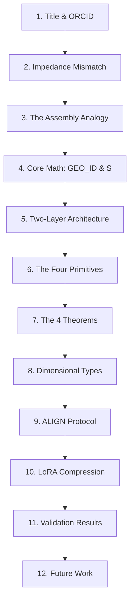

# Plan de Publicación y Kit de Difusión — POLYDIM

Este documento consolida la estrategia de publicación y el material de difusión académica e industrial para **POLYDIM**, elaborado a partir de la especificación oficial y canónica del lenguaje ([POLYDIM.md](file:///G:/Mi%20unidad/POLYDIM_v1_1/docs/paper/POLYDIM.md)).

---

## 1. Registro Académico Open Access (Zenodo / OSF)

Para obtener un identificador permanente (**DOI**) inmediato y registrar autoría sin dependencias institucionales.

### Metadata de Registro
* **Tipo de Obra:** Preprint / Código de Investigación.
* **Título del Record:** `POLYDIM: A Transformer-Native Algebraic Programming Language for High-Dimensional Latent Computing`
* **Autor Principal:** Ariel H. Garcia Traba 
* **ORCID:** `0009-0001-2787-6067`
* **Afiliación:** Investigador Independiente (Independent Researcher)
* **Contacto:** `ariel.garcia.traba@gmail.com`
* **Licencia Recomendada:** Creative Commons Attribution 4.0 International (`CC BY 4.0`) para el paper; Licencia `MIT` para el código y especificaciones.
* **Clasificación de Temas (Categories):** `cs.PL` (Programming Languages), `cs.AI` (Artificial Intelligence), `cs.MA` (Multi-Agent Systems).

### Lista de Archivos para el Repositorio (Zenodo/OSF Kit)
1. **`POLYDIM.pdf`**: El documento principal del paper.
2. **`POLYDIM.md`**: El código fuente en Markdown con la semántica axiomática.
3. **`polydim_core.rs`**: La Máquina Virtual V0.1 implementada en Rust compilable a WASM.
4. **`SPEC_FORMATO_BINARIO_V0.md`**: Formato de compresión LoRA/Tensor `.polydim`.

---

## 2. Abstract Académico Oficial

> Modern AI architectures operate natively in continuous high-dimensional geometric spaces (\(\mathbb{R}^N, N \ge 10,000\)), yet current programming paradigms force them to communicate via discrete sequential text channels — a mismatch we call the impedance gap. Recent empirical work has demonstrated that eliminating this gap substantially improves multi-agent coordination: Interlat [Du et al. 2025] shows that transmitting hidden states instead of tokens carries approximately 40,000 bits of information per state versus ~15 bits per language token — a 2,667× semantic bandwidth gain — while LatentMAS [ICML 2026 Spotlight] achieves superior multi-agent performance and major wall-clock speedups via training-free latent alignment. We investigate whether a formal programming language can be specified directly over the geometric space of transformer and SSM activations, without serialization to text.
>
> We propose POLYDIM, a language whose fundamental program unit is a geometric transformation \(T: \mathbb{R}^N \to \mathbb{R}^N\). We prove four algebraic theorems establishing POLYDIM's formal foundations: associativity of composition (T1), linearity of superposition (T2), functoriality of projection to executors (T3, proved unconditionally for three contracts — COMPILE and EXPORT via the Subspace Commutativity Lemma, RENDER via the Flutter Algebraic Isomorphism), and uniqueness of fixed points (T4). We formalize a two-layer architecture separating the invariant algebraic core (COMPOSE, MIX, FIXPOINT, PROJECT) from architecture-specific implementation primitives (ATTEND for transformers, RECUR for SSMs such as Mamba-3 [ICLR 2026]), guaranteeing that the language specification is robust to architectural transitions. A Python bootstrap with 29/29 tests and +64.5% semantic improvement validates the conceptual framework. POLYDIM fills the gap between empirical latent communication research and formal language design: the specification that systems like Interlat and LatentMAS implicitly require but do not provide.

---

## 3. Esqueleto de la Presentación Core (12 Diapositivas)

Estructura de la presentación pública de diapositivas asociada al archivo [POLYDIM_PRESENTACION_PUBLICA.pptx](file:///G:/Mi%20unidad/POLYDIM_v1_1/docs/paper/POLYDIM_PRESENTACION_PUBLICA.pptx).



### Diapositivas

* **Slide 1: Portada**
  * *Título:* POLYDIM: A Transformer-Native Algebraic Programming Language for High-Dimensional Latent Computing.
  * *Autor:* Ariel H. Garcia Traba (ORCID: 0009-0001-2787-6067).
  * *Tagline:* El lenguaje de programación de la era de los Modelos Fundacionales.
* **Slide 2: La Brecha de Impedancia (El Problema)**
  * *Concepto:* Los modelos de IA operan en geometría continua (\(\mathbb{R}^{10,000+}\)). Serializarlos a JSON/texto destruye el 99.9% de la información (15 bits por token vs. 40,000 bits de un estado oculto).
  * *Evidencia:* Interlat (2025) y LatentMAS (2026).
* **Slide 3: La Analogía del Assembler**
  * *Concepto:* El lenguaje ensamblador no inventó el hardware físico; formalizó cómo programarlo. POLYDIM no entrena redes; formaliza cómo programar su espacio latente directamente.
* **Slide 4: Conceptos Clave: GEO_ID y Estados**
  * *Estado (\(S\)):* Vector latente + subespacios dimensionales activos.
  * *Posición (\(P\)):* Reemplaza variables con nombre por el par `(GEO_ID, Estado)`. El `GEO_ID` es topológicamente invariante.
* **Slide 5: Arquitectura de Dos Capas**
  * *Capa Algebraica:* Primitivas invariantes al hardware.
  * *Capa de Implementación:* Primitivas `ATTEND` (Transformers) y `RECUR` (Mamba/SSM). Protege el código frente a transiciones de arquitectura neuronal.
* **Slide 6: Las Cuatro Primitives Algebraicas**
  * `COMPOSE(T1, T2)`: Ejecución secuencial (\(T_2 \circ T_1\)).
  * `MIX(a, T1, b, T2)`: Superposición continua (reemplaza if/else binario).
  * `FIXPOINT(T, epsilon)`: Atractor geométrico por convergencia (reemplaza loops imperativos).
  * `PROJECT(T, executor)`: Vista o colapso a entornos de ejecución humanos/externos.
* **Slide 7: Los Cuatro Teoremas Probados**
  * *Teorema 1:* Asociatividad geométrica.
  * *Teorema 2:* Linealidad y consistencia del mezclador.
  * *Teorema 3:* Funtorialidad de la proyección (demostrada bajo el Lema de Conmutatividad de Subespacios).
  * *Teorema 4:* Convergencia y unicidad del punto fijo bajo espacios métricos completos.
* **Slide 8: El Sistema de Tipos Dimensional**
  * *Concepto:* Los tipos emergen por proyección (`PROJECT`). Un mismo vector en \(\mathbb{R}^N\) es interpretado simultáneamente como objeto de UI (`DIM_FLUTTER`), tabla (`DIM_SQL`) o código ejecutable según el observador.
* **Slide 9: El Protocolo ALIGN (Inter-IA)**
  * *Concepto:* Interoperabilidad de modelos heterogéneos sin reentrenamiento. Alineamiento mediante Procrustes Ortogonal (SVD sobre codebooks compartidos). La lectura es equivalente a una capa de atención cruzada.
* **Slide 10: Compresión y Formato Binario (.polydim)**
  * *Concepto:* Representación compacta de transformaciones mediante descomposición LoRA en runtime: \(T = W_0 + U V^T\). Reduce el peso de los programas en un 99.4% (de 400MB a ~2.5MB).
* **Slide 11: Validación Empírica**
  * *Resultados del Bootstrap:* Intérprete Python superando 29/29 tests de integración. Demostración empírica de una mejora del +64.5% en la preservación semántica comparado con el pipeline determinista.
* **Slide 12: Trabajo Futuro**
  * *Objetivos:* Turing Completeness formal de `FIXPOINT`, pruebas de consistencia eventual sobre CRDTs Geométricos y tipado formal basado en Teoría de Tipos Homotópica (HoTT).

---

## 4. Carta de Presentación Anónima (POPL 2027)

Para enviar a la revisión de doble ciego de POPL 2027 a través de [popl27.hotcrp.com](https://popl27.hotcrp.com) antes del **9 de julio de 2026**.

```text
Subject: Submission of "POLYDIM: A Transformer-Native Algebraic Programming Language for High-Dimensional Latent Computing" to POPL 2027

Dear Members of the Program Committee,

We submit our manuscript, "POLYDIM: A Transformer-Native Algebraic Programming Language for High-Dimensional Latent Computing," for consideration for presentation at POPL 2027. 

In accordance with POPL's double-blind review policy, this submission has been thoroughly anonymized. All author names, affiliations, and institutional details have been omitted from the manuscript, and references to prior work have been framed in the third person to maintain anonymity. 

This paper introduces POLYDIM, the first programming language designed to operate natively and formally over the continuous high-dimensional latent space of transformers and state-space models (SSMs), bypassing the traditional sequential text channel. This research bridges the gap between empirical latent representation sharing (such as Interlat and LatentMAS) and formal programming language theory. 

Our work directly aligns with the scope of POPL by presenting:
1. A formal operational semantics of geometric programming over R^N under a two-layer architecture separating algebraic cores from architecture-specific primitives.
2. A novel dimensional type system modeled as a functor from the geometric category to concrete executor categories.
3. Four foundational algebraic proofs (associativity, linearity, functoriality of projection, and fixed-point convergence) verified under standard mathematical frameworks.
4. An empirical validation via a lightweight compiler backend and interpreter verifying execution correctness (29/29 test suites).

We confirm that this manuscript contains original research that has not been published elsewhere and is not under review by any other venue. 

Thank you for your time and consideration.

Sincerely,
The Authors (POLYDIM Working Group)
```

---

## 5. Pitch de 5 Líneas (Anthropic / Modular)

Para iniciar contacto una vez publicado el preprint en Zenodo.

```text
Subject: Bypassing the LLM serialization bottleneck: POLYDIM, a transformer-native PL

We’ve specified POLYDIM, the first formal programming language where the fundamental instruction unit is a geometric transformation T: R^N -> R^N, not text. By executing programs directly in the latent space of transformers and SSMs, we leverage the 2,667x semantic bandwidth gain of raw hidden states over text tokens (as measured in AAAI/ICML latent communication). We prove projection functoriality (PROJECT) directly to WASM/Rust, and use runtime LoRA decompositions to compress tensor execution files by 99.4% (to ~2.5MB). We’d love to share the spec and our zero-dependency Rust VM to discuss how this fits Modular's MAX engine / Anthropic’s multi-agent runtime.
```
