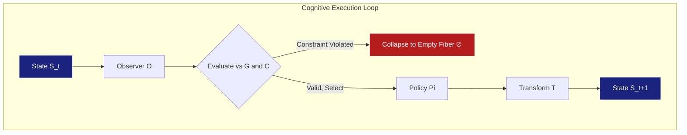
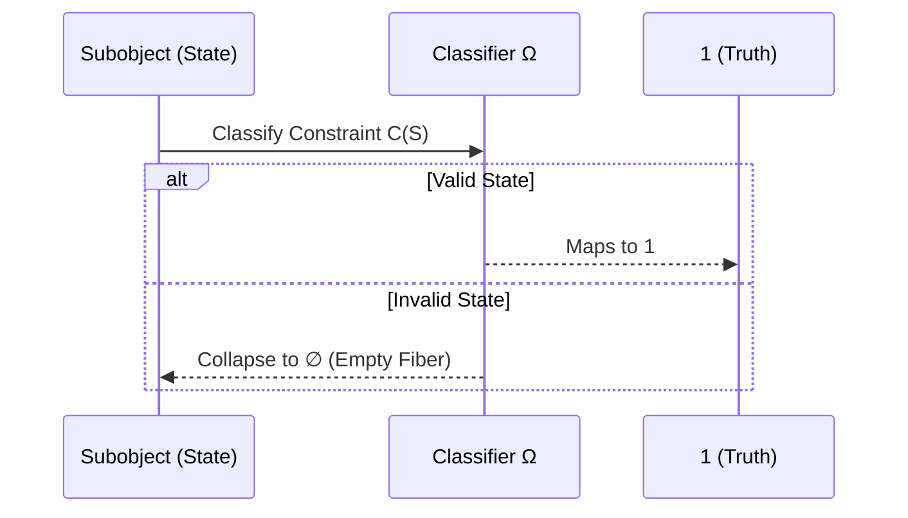

# POLYDIM CONSTITUTION: Formal Axiomatics and Topological Foundations for Cognitive Programming  
**Version 3.0 (Formal Edition) – Draft for POPL 2027**

---

## Abstract  
This document delineates the rigorous mathematical underpinnings of Cognitive Programming and the POLYDIM framework. Departing from classical algorithmic paradigms, we formalize computational processes whose behavior emerges from the directed evolution of internal representations. Leveraging Topos Theory, Clifford Algebras, and Algebraic Topology, we construct a geometric epistemology for representational space computing, ensuring both theoretical coherence and operational correctness.

---

## 1. The Epistemological Shift: From Algorithms to Cognitive Processes  

The classical computational paradigm is predicated on the deterministic execution of explicit algorithms within discrete state machines. The emergence of representation-learning systems necessitates a profound epistemological reorientation. Program execution is no longer confined to the traversal of predefined imperative sequences but is instead characterized by the constrained evolution of an internal representational space directed toward a semantic objective.  

This constitutes the foundational premise of **Cognitive Programming**.  
- **Classical Paradigm:** $\text{Program} \xrightarrow{} \text{Algorithm} \xrightarrow{} \text{Result}$  
- **Cognitive Paradigm:** $\text{Objective} \xrightarrow{} \text{Cognitive Process} \xrightarrow{} \text{Result}$  

### 1.1 The Cognitive Program Tuple  
A Cognitive Program is formally defined as an axiomatic system encapsulated by the following 6-tuple:  
$$ P = (S, G, T, O, C, \Pi) $$  
Where:  
- $S$ (State): The complete representational manifold pertinent to cognitive deliberation.  
- $G$ (Goal): The semantic target delineating valid evolutionary trajectories.  
- $T$ (Transformation): An endomorphism over the state space, $T: S \to S$.  
- $O$ (Observer): A functor interpreting the state space into a semantic target space, $O: S \to M$.  
- $C$ (Constraint): An invariant logical predicate, $C(S) \equiv \text{True}$.  
- $\Pi$ (Policy): The meta-rule governing the selection of the transformation $T$.  

---

## 2. Axiomatic Theory of Polydimensions  

The mathematical core of POLYDIM formalizes representational computation as a topological object. A Polydimension is defined as the tuple:  
$$ \mathbb{P} = (D, \Pi_P, \mathcal{T}, \Omega) $$  
Where:  
- $D$: A bounded set of topological dimensions (e.g., the continuous latent manifold $\mathbb{R}^{10000}$ or the discrete schema $\mathbb{Z}^2$).  
- $\Pi_P$: The set of valid projection functors that collapse high-entropy spaces while strictly preserving homotopic invariance (subsuming the abstract `PROJECT` functor).  
- $\mathcal{T}$: The monoid of admissible transformations preserving the topological identity (`GEO_ID`), encompassing primitive operators such as `COMPOSE`, `MIX`, and `FIXPOINT`.  
- $\Omega$: The subobject classifier governing the internal intuitionistic logic of the underlying spatial topos.  

### 2.1 The Seven Axioms of Execution  
1. **Axiom I (State Existence):** Every cognitive program possesses a non-empty representational state $S$.  
2. **Axiom II (Observability):** Every state admits an observation functor $O$.  
3. **Axiom III (Transformative Closure):** Every transformation $T \in \mathcal{T}$ maps to a valid state $S' \in D$.  
4. **Axiom IV (Composability):** The transformation monoid $\mathcal{T}$ is strictly composable.  
5. **Axiom V (Teleology):** Execution is strictly bound to an explicit objective $G$.  
6. **Axiom VI (Constraint Evaluation):** The execution trajectory can be evaluated against $C$ at any arbitrary point.  
7. **Axiom VII (Deliberative Plasticity):** The policy $\Pi$ is mutable during execution.  

---

## 3. Universal Mathematical Foundations (Level 1)  

POLYDIM relies upon an immutable corpus of pure mathematics to guarantee operational correctness.  

### 3.1 Topology and Category Theory  
- **Yoneda Lemma:** Guarantees that any object is entirely determined by its morphisms to other objects, proving the existence and uniqueness of the universal `GEO_ID`.  
$$ \text{Hom}(\text{Hom}(-, X), F) \cong F(X) $$  
- **Grothendieck Topos Theory:** Limits, colimits, and representability justify the employment of intuitionistic logic. Invalid states gracefully collapse to the empty fiber ($\emptyset$) without disrupting the topological continuity of the manifold.  

### 3.2 Geometric Algebra (Clifford Algebras)  
- **Cartan-Dieudonné Theorem:** Any orthogonal transformation in dimension $n$ is a composition of at most $n$ reflections. This theoretically bounds the complexity of rotor operations (Spin) within the `MIX` operator and ensures the viability of low-rank adaptations (LoRA).  
- **Hodge Decomposition:** Permits the partitioning of vector fields into divergence-free (harmonic) and rotational components. This is the mechanism by which `FIXPOINT` purges hallucination and noise during convergence loops.  
$$ \omega = d\alpha + \delta\beta + \gamma $$  

### 3.3 Algebraic Topology & Optimization  
- **Freudenthal Suspension Theorem:** Enables the elevation of low-dimensional invariants to higher spaces, fundamentally justifying the mapping of discrete semantics to continuous, high-dimensional multivector spaces.  
- **Gauss-Markov / Fisher-Rao Adjunction:** Ensures that manifold state updates traverse optimal information geodesics, formalizing the concept of "semantic gravity" toward attractors.  

---

## 4. Derived Structural Theorems (Level 2)  

Within the $\mathbb{P} = (D, \Pi_P, \mathcal{T}, \Omega)$ framework, the following theorems are strictly derivable.  

**Theorem 1 (Fundamental Theorem of Polydimensions):** Every admissible transformation $T \in \mathcal{T}$ induces a covariant morphism between compatible polydimensions.  

**Theorem 2 (GEO_ID Preservation):** If $T \in \mathcal{T}$ is a valid transformation (e.g., `MIX`, `COMPOSE`), the central topological identity is invariant under projection.  
$$ \forall T \in \mathcal{T}, \text{GeoID}(T(x)) \simeq \text{GeoID}(x) \text{ (up to homotopy equivalence)} $$  

**Theorem 3 (Projection Commutativity):** Under strict semantic isotropy, the projection sequence commutes. In the general case, commutativity is bounded by the torsion tensor of the latent manifold.  
$$ \text{PROJECT}_B(\text{PROJECT}_A(x)) \simeq \text{PROJECT}_A(\text{PROJECT}_B(x)) $$  

**Theorem 4 (Semantic Tomography / Reconstruction):** Given sufficient compatible orthogonal projections $\pi_i \in \Pi_P$, there exists an asymptotic limit by which the original high-dimensional continuous tensor can be losslessly reconstructed (isomorphic to the Radon Transform in integral geometry).  

---

## 5. Architectural Conjectures (Level 3)  

The following principles are formal postulates awaiting complete constructive proofs (e.g., in Cubical Agda).  

- **Conjecture 1 (Strict Monoidal Impossibility of Softmax Attention):** Dense attention mechanisms cannot descend to a non-trivial algebraic quotient without violating functoriality. *(Relaxed pragmatically in applied environments).*  
- **Conjecture 2 (Functoriality of the PROJECT Operator):** The translation from geometric semantics to discrete nominal types perfectly preserves all limits of the underlying topos.  
- **Conjecture 3 (Universal Linear Alignment - ALIGN):** Optimal Transport (formerly postulated via CCA/Procrustes) can discover exact isomorphisms between stochastically trained manifolds.  

---

## 6. The Theorem of Cognitive Preservation  

The paramount mathematical challenge of Cognitive Programming is proving the conditions under which a reasoning process preserves the initial objective $G$ while strictly satisfying constraints $C$ across varying computational substrates (models).  

Compilation in POLYDIM transcends syntax translation; it is the **homomorphic preservation of the cognitive process**. Solving the Theorem of Cognitive Preservation is mathematically isomorphic to the total eradication of "hallucination" and "objective drift."  

---  
*This Constitution codifies the definitive epistemological and mathematical architecture of POLYDIM V3.0, bridging topological idealism with demonstrable computational rigor.*