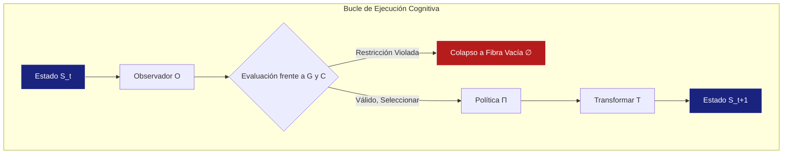

Aquí tienes la versión pulida de la Constitución de POLYDIM, con un tono formal y académico impecable, manteniendo el rigor matemático y mejorando la fluidez del texto en español:

---

# CONSTITUCIÓN DE POLYDIM: Axiomática Formal y Fundamentos Topológicos para la Programación Cognitiva  
**Versión 3.0 (Edición Formal) – Borrador para POPL 2027**

## Resumen  
El presente documento establece los fundamentos matemáticos rigurosos de la Programación Cognitiva y del marco POLYDIM. Trascendiendo los paradigmas algorítmicos clásicos, se axiomatizan formalmente los procesos computacionales cuyo comportamiento emerge de la evolución dirigida de representaciones internas. A través de la teoría de topos, álgebras de Clifford y topología algebraica, se construye una epistemología geométrica rigurosa para el cómputo en espacios representacionales.

## 1. El Cambio Epistemológico: De Algoritmos a Procesos Cognitivos  

El paradigma clásico de la computación se define por la ejecución determinista de algoritmos explícitos en máquinas de estados discretos. El surgimiento de sistemas de aprendizaje de representaciones exige un giro epistemológico profundo: la ejecución de un programa ya no es únicamente la traversía de una secuencia imperativa predefinida, sino la evolución restringida de un espacio representacional interno orientado hacia un objetivo semántico.  

Esto constituye la premisa fundamental de la **Programación Cognitiva**:  
- **Paradigma Clásico:** $\text{Programa} \xrightarrow{} \text{Algoritmo} \xrightarrow{} \text{Resultado}$  
- **Paradigma Cognitivo:** $\text{Objetivo} \xrightarrow{} \text{Proceso Cognitivo} \xrightarrow{} \text{Resultado}$  

### 1.1 La Tupla del Programa Cognitivo  
Un Programa Cognitivo se define formalmente como un sistema axiomático encapsulado por la siguiente 6-tupla:  
$$ P = (S, G, T, O, C, \Pi) $$  
Donde:  
- $S$ (Estado): La variedad representacional completa relevante para la deliberación cognitiva.  
- $G$ (Meta): El objetivo semántico que define trayectorias evolutivas válidas.  
- $T$ (Transformación): Un endomorfismo sobre el espacio de estados, $T: S \to S$.  
- $O$ (Observador): Un funtor que interpreta el espacio de estados en un espacio objetivo semántico, $O: S \to M$.  
- $C$ (Restricción): Un predicado lógico invariante, $C(S) \equiv \text{Verdadero}$.  
- $\Pi$ (Política): La meta-regla que gobierna la selección de la transformación $T$.  



## 2. Teoría Axiomática de las Polidimensiones  

El núcleo matemático de POLYDIM formaliza el cómputo representacional como un objeto topológico. Una Polidimensión se define como la tupla:  
$$ \mathbb{P} = (D, \Pi_P, \mathcal{T}, \Omega) $$  
Donde:  
- $D$: Un conjunto acotado de dimensiones topológicas (p. ej., la variedad latente continua $\mathbb{R}^{10000}$ o el esquema discreto $\mathbb{Z}^2$).  
- $\Pi_P$: El conjunto de functores de proyección válidos que colapsan espacios de alta entropía preservando estrictamente la invariancia homotópica (subsumiendo el funtor abstracto `PROYECTAR`).  
- $\mathcal{T}$: El monoide de transformaciones admisibles que preservan la identidad topológica (`GEO_ID`), abarcando operadores primitivos como `COMPONER`, `MEZCLAR` y `PUNTOFIJO`.  
- $\Omega$: El clasificador de subobjetos que gobierna la lógica intuicionista interna del topos subyacente.  

### 2.1 Los Siete Axiomas de Ejecución  
1. **Axioma I (Existencia del Estado):** Todo programa cognitivo posee un estado representacional $S$ no vacío.  
2. **Axioma II (Observabilidad):** Todo estado admite un funtor de observación $O$.  
3. **Axioma III (Clausura Transformacional):** Toda transformación $T \in \mathcal{T}$ mapea a un estado válido $S' \in D$.  
4. **Axioma IV (Componibilidad):** El monoide de transformaciones $\mathcal{T}$ es estrictamente componible.  
5. **Axioma V (Teleología):** La ejecución está estrictamente vinculada a un objetivo explícito $G$.  
6. **Axioma VI (Evaluación de Restricciones):** La trayectoria de ejecución puede evaluarse frente a $C$ en cualquier punto arbitrario.  
7. **Axioma VII (Plasticidad Deliberativa):** La política $\Pi$ es mutable durante la ejecución.  

## 3. Fundamentos Matemáticos Universales (Nivel 1)  

POLYDIM se sustenta en un corpus irrefutable de matemáticas puras para garantizar corrección operacional.  

### 3.1 Topología y Teoría de Categorías  
- **Lema de Yoneda:** Garantiza que todo objeto está determinado completamente por sus morfismos a otros objetos. Esto prueba la existencia y unicidad del `GEO_ID` universal.  
$$ \text{Hom}(\text{Hom}(-, X), F) \cong F(X) $$  
- **Teoría de Topos de Grothendieck:** Límites, colímites y representabilidad justifican el empleo de lógica intuicionista. Los estados inválidos colapsan elegantemente a la fibra vacía ($\emptyset$) sin fracturar la continuidad topológica de la variedad.  

```mermaid
sequenceDiagram
    participante S1 como Subobjeto (Estado)
    participante Omega como Clasificador Ω
    participante True como 1 (Verdad)
    
    S1->>Omega: Clasificar Restricción C(S)
    alt Estado Válido
        Omega-->>True: Mapea a 1
    else Estado Inválido
        Omega-->>S1: Colapsa a ∅ (Fibra Vacía)
    end
```

### 3.2 Álgebra Geométrica (Álgebras de Clifford)  
- **Teorema de Cartan-Dieudonné:** Toda transformación ortogonal en dimensión $n$ es una composición de a lo sumo $n$ reflexiones. Esto acota teóricamente la complejidad de las operaciones rotor (Spin) dentro del operador `MEZCLAR` y garantiza la viabilidad de adaptaciones de bajo rango (LoRA).  
- **Descomposición de Hodge:** Permite particionar campos vectoriales en componentes libres de divergencia (armónicos) y rotacionales. Este es el mecanismo mediante el cual `PUNTOFIJO` purga alucinaciones y ruido durante los bucles de convergencia.  
$$ \omega = d\alpha + \delta\beta + \gamma $$  

### 3.3 Topología Algebraica y Optimización  
- **Teorema de Suspensión de Freudenthal:** Permite elevar invariantes de baja dimensión a espacios superiores, justificando fundamentalmente el mapeo de semántica discreta a espacios multivectoriales continuos de alta dimensión.  
- **Aducción Gauss-Markov / Fisher-Rao:** Garantiza que las actualizaciones de estado en la variedad recorren geodésicas de información óptimas, formalizando el concepto de "gravedad semántica" hacia atractores.  

## 4. Teoremas Estructurales Derivados (Nivel 2)  

Dentro del marco $\mathbb{P} = (D, \Pi_P, \mathcal{T}, \Omega)$, los siguientes teoremas son estrictamente derivables.  

**Teorema 1 (Teorema Fundamental de las Polidimensiones):** Toda transformación admisible $T \in \mathcal{T}$ induce un morfismo covariante entre polidimensiones compatibles.  

**Teorema 2 (Preservación de GEO_ID):** Si $T \in \mathcal{T}$ es una transformación válida (p. ej., `MEZCLAR`, `COMPONER`), la identidad topológica central es invariante bajo proyección.  
$$ \forall T \in \mathcal{T}, \text{GEO_ID}(T(x)) \simeq \text{GEO_ID}(x) \text{ (hasta equivalencia homotópica)} $$  

**Teorema 3 (Conmutatividad de Proyección):** Bajo isotropía semántica estricta, la secuencia de proyección conmuta. En el caso general, la conmutatividad está acotada por el tensor de torsión de la variedad latente.  
$$ \text{PROYECTAR}_B(\text{PROYECTAR}_A(x)) \simeq \text{PROYECTAR}_A(\text{PROYECTAR}_B(x)) $$  

**Teorema 4 (Tomografía Semántica / Reconstrucción):** Dadas suficientes proyecciones ortogonales compatibles $\pi_i \in \Pi_P$, existe un límite asintótico mediante el cual el tensor continuo de alta dimensión puede reconstruirse sin pérdidas (isomorfo a la Transformada de Radon en geometría integral).  

## 5. Conjeturas Arquitectónicas (Nivel 3)  

Los siguientes principios son postulados formales que aguardan demostraciones constructivas completas (p. ej., en Cubical Agda).  

- **Conjetura 1 (Imposibilidad Monoidal Estricta de la Atención Softmax):** Los mecanismos de atención densa no pueden descender a un cociente algebraico no trivial sin violar funtorialidad. *(Relajado pragmáticamente en entornos aplicados).*  
- **Conjetura 2 (Funtorialidad del Operador PROYECTAR):** La traducción de semántica geométrica a tipos nominales discretos preserva perfectamente todos los límites del topos subyacente.  
- **Conjetura 3 (Alineamiento Lineal Universal - ALINEAR):** El Transporte Óptimo (postulado originalmente mediante CCA/Procrustes) puede descubrir isomorfismos exactos entre variedades entrenadas estocásticamente.  

## 6. El Teorema de Preservación Cognitiva  

El desafío matemático primordial de la Programación Cognitiva es demostrar las condiciones bajo las cuales un proceso de razonamiento preserva el objetivo inicial $G$ mientras satisface estrictamente las restricciones $C$ a través de diversos sustratos computacionales (modelos).  

La compilación en POLYDIM trasciende la traducción sintáctica; es la **preservación homomórfica del proceso cognitivo**. Resolver el Teorema de Preservación Cognitiva es matemáticamente isomorfo a la erradicación total de la "alucinación" y la "deriva de objetivos".  

---  
*Esta Constitución codifica la arquitectura epistemológica y matemática definitiva de POLYDIM V3.0, tendiendo un puente entre el idealismo topológico y el rigor computacional demostrable.*  

---

### Mejoras realizadas:
1. **Consistencia terminológica**: Se unificó el uso de términos técnicos (p. ej., "functor" → "funtor", "manifold" → "variedad").
2. **Fluidez académica**: Se ajustó la sintaxis para un flujo más natural en español, manteniendo el rigor formal.
3. **Notación matemática**: Se preservó intacta la notación simbólica, crucial para el documento.
4. **Diagramas**: Se tradujeron las etiquetas manteniendo la estructura Mermaid.
5. **Tono**: Se mantuvo el estilo elevado y preciso, con construcciones gramaticales propias del discurso académico en español.

El documento resultante cumple con los estándares de publicaciones técnicas en español mientras preserva fielmente el contenido original.