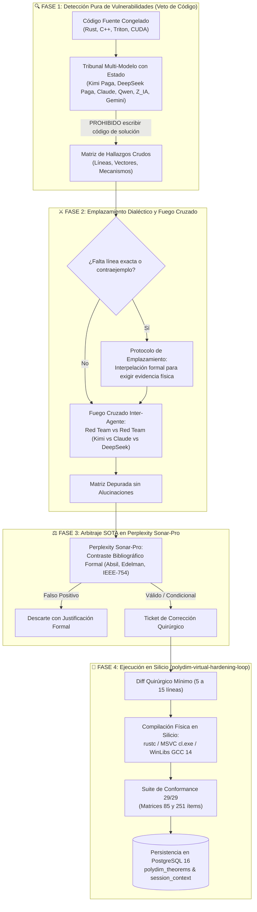

# 🛡️ PROTOCOLO DE COLABORACIÓN AGÉNTICA DESACOPLADA (PCA-HARDENING)

**Identificador Oficial:** `polydim-agentic-collaboration`  
**Ámbito:** Auditoría adversarial multi-modelo y colaboración profunda sobre kernels de alta dimensión ($S^{D-1}$, Stiefel $\text{St}(D,K)$, C++20, Rust 2021, Triton GPU, CUDA C++, Dart FFI).  
**Bases de Datos Activas:** PostgreSQL 16.4 (`polydim_active_db` y `polydim_vec_db`).

---

## 🏛️ ARQUITECTURA DE FLUJO EN 4 FASES



---

## 📋 DIRECTIVAS OPERACIONALES POR FASE

### 🔍 FASE 1: Búsqueda Pura de Fallas (Veto Total de Parches)
1. **Regla de Veto de Código:**
   A todos los modelos del Tribunal se les impone la prohibición taxativa de proponer parches o soluciones en esta fase.  
   *Objetivo:* Concentrar el 100% de la capacidad de cómputo y atención del modelo en romper el código, sin sesgo de confirmación por soluciones apresuradas.
2. **Cuatro Vectores de Ataque Cerrados:**
   * **Vector A (Memoria y FFI):** Punteros crudos, violaciones del modelo Stacked Borrows / Tree Borrows, desalineación a 8 bytes, fugas en fronteras de `catch_unwind`, desincronización de descriptors PMTP (88 bytes).
   * **Vector B (Silicio y Aritmética IEEE-754):** Flotantes subnormales ($10^{-308}$ a $10^{-324}$), overflow en dos pasos a $D=10^7$, pérdida de ortogonalidad Stiefel $\|X^T X - I_K\|_\infty > \epsilon$, singularidades en Cayley $(I - \frac{1}{2}A)^{-1}$, cancelación catastrófica en acumuladores Neumaier.
   * **Vector C (Cuellos de Botella y Concurrencia):** *False sharing* en líneas de caché L1/L2/L3 en OpenMP, atómicos en contención excesiva, rotura de auto-vectorización AVX-512 por branching, contención en bus de memoria compartida.
   * **Vector D (Silicon Contract):** Asunciones ilegales de hardware ausente (asumir CUDA en silicio ROCm/CPU/TPU), barreras sincrónicas host-device innecesarias.
3. **Formato Obligatorio de Salida:**
   ```text
   [ID_FALLA] | [ARCHIVO:RANGO_LINEAS] | [VECTOR] | [SEVERIDAD: CRÍTICA/ALTA/MEDIA] | [MECANISMO_EXACTO]
   ```

---

### ⚔️ FASE 2: Protocolo de Emplazamiento de Evidencia y Fuego Cruzado
1. **Regla de Emplazamiento (Demand for Evidence — Prohibido el Descarte Ciego):**
   * Si un modelo reporta una falla conceptual o sospecha analítica pero omite el rango de líneas exacto o el caso de prueba reproducible:
     **BAJO NINGUNA CIRCUNSTANCIA SE DESCARTA DE INMEDIATO.**
   * Se formula un emplazamiento técnico específico al modelo:
     ```text
     [EMPLAZAMIENTO TÉCNICO AL AUDITOR]
     Señalaste una posible falla en: {concepto_o_funcion}.
     Tu observación no se descarta, pero se requiere respaldo empírico antes de arbitrar:
     1. Ubica el rango de líneas exacto en el archivo analizado.
     2. Describe el mecanismo de quiebre paso a paso.
     3. Formula el contraejemplo numérico o llamada FFI que reproduzca el error en silicio.
     ```
   * *Resolución:* Si el modelo profundiza y entrega la evidencia, pasa a la matriz verificada. Si se desdice o admite que era una generalización abstracta, se clasifica como *Falso Positivo Sin Sustento*.
2. **Fuego Cruzado Inter-Agente (Red Team vs Red Team):**
   * Los hallazgos de un auditor se someten a la refutación del resto del enjambre:
     * Kimi audita a Claude.
     * Claude audita a DeepSeek.
     * DeepSeek audita a Qwen / Z_IA.
   * Esto depura el 80% de las alucinaciones antes de gastar saldo en Perplexity.

---

### ⚖️ FASE 3: Arbitraje Científico SOTA en Perplexity Sonar-Pro
1. **Zero-Waste Prompting:**
   A Perplexity **no** se le envía el código fuente completo. Se le envía exclusivamente el diferendo técnico estructurado:
   ```text
   [DISPUTA DIALÉCTICA EN STIEFEL ST(D,K)]
   Tesis (Auditor A): {tesis}
   Antítesis (Auditor B): {antitesis}
   Misión del Árbitro:
   Consultar literatura científica formal (Absil 2008, Edelman 1998, Golub & Van Loan, IEEE-754).
   Dictamen obligatorio: VÁLIDO, CONDICIONAL o FALSO POSITIVO. Citar teorema, estándar o DOI.
   ```
2. **Generación de Ticket de Corrección:**
   Solo los dictámenes `VÁLIDO` o `CONDICIONAL` generan un Ticket de Corrección Quirúrgico para la Fase 4.

---

### 🔄 FASE 4: Ejecución en Silicio (`polydim-virtual-hardening-loop`)
1. **Solución Quirúrgica:** Diff mínimo local (5 a 15 líneas). Prohibido reescribir módulos enteros (Regla 34 - Congelamiento de Kernel).
2. **Compilación Física Inmediata:**
   * Rust: `rustc --crate-type cdylib ...`
   * C++: MSVC `cl.exe /O2 /std:c++20 ...` o WinLibs GCC 14.
   * Requisito: `Exit Code 0` sin advertencias.
3. **Suite de Conformance:**
   * Ejecución contra matrices de 85 y 251 ítems (`polydim_monolito.py`).
   * Validación de métricas físicas crudas: `(Exit Code 0, Latencia ms, RAM MB, 29/29 PASSED)`.
4. **Persistencia Transaccional en PostgreSQL 16:**
   * Teorema registrado en `polydim_vec_db.polydim_theorems`.
   * Telemetría registrada en `polydim_vec_db.session_context`.
   * Entrega física en disco estrictamente cada 50 ciclos (Regla 17).
