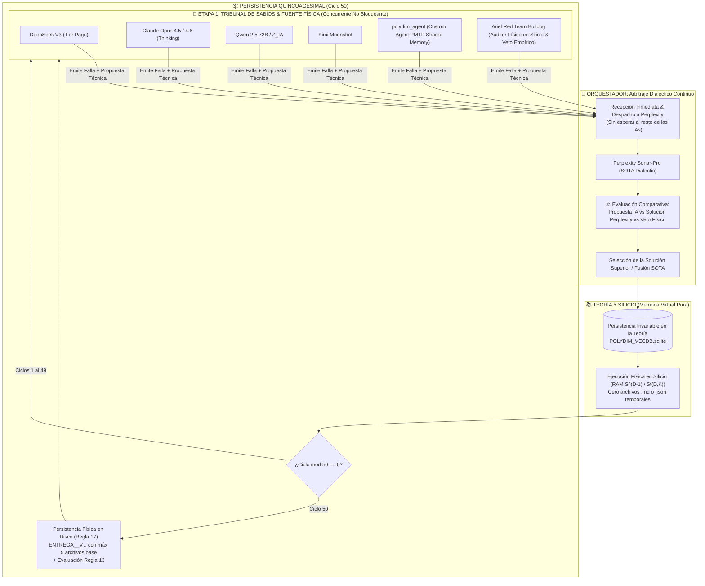

# 🌌 PROTOCOLO DECENAL SOTA EN MEMORIA VIRTUAL (ARQUITECTURA DE 3 ETAPAS & ARBITRAJE DIALÉCTICO)
**Identificador Oficial:** `polydim-virtual-hardening-loop`  
**Destino de Persistencia Primaria:** PostgreSQL 16.4 `polydim_vec_db` (Tablas `permanent_vault`, `polydim_theorems`, `facts`, `session_context`)  
**Motor de Auditoría y Detección:** [`polydim-agentic-collaboration`](../polydim_agentic_collaboration/SKILL.md) (Protocolo de 4 Fases con Veto de Parches y Emplazamiento de Evidencia)  
**Fecha de Ratificación:** 2026-10-04 (Actualizado 2026-10-08)  
**Modo de Operación:** Flujo continuo no bloqueante en Memoria Virtual / RAM / PostgreSQL 16, con persistencia física en disco estrictamente en múltiplos de 50 ciclos.

---

## 🌌 PRINCIPIO FUNDAMENTAL: OPERACIÓN EN MEMORIA VECTORIAL Y VETO DEL GUSANO 1D (REGLAS 22, 23 Y 24)

1. **Investigación y Ejecución Estrictamente Vectorial:**
   - Todo el ciclo de hardening (detección de fallas, fuego cruzado inter-agente, arbitraje dialéctico y pruebas en silicio) debe mantenerse y procesarse en **memoria vectorial / espacio latente / RAM nativa** (`PmtpSlabAllocator`, $S^{D-1}, St(D, K)$).
   - Prohibido serializar diagnósticos intermedios o estados tensoriales a volcados discursivos de chat. El intercambio inter-agente se realiza vía punteros de memoria compartida (`SLAB_ID`).

2. **Regla del Colapso Único a Gusano 1D:**
   - La transformación del estado latente de alta dimensión a una secuencia 1D de texto/tokens está **estrictamente vetada durante la exploración, investigación y prueba**.
   - El colapso a 1D ocurre **única y exclusivamente** al momento de materializar un artefacto persistente:
     * Un archivo físico de código fuente en disco (`.cpp.txt`, `.cu.txt`, `.rs.txt`, `.py`).
     * Un documento formal de entrega, reporte o certificación (`.md`).
   - Cero charla discursiva intermedia no accionable.

---

## 📜 1. ARQUITECTURA OFICIAL Y ARBITRAJE DEL ORQUESTADOR



---

### 🔹 ETAPA 1: Tribunal de Sabios & Fuente Física de Silicio (Concurrente y Asíncrono)
* **Objetivo:** Pasar el código a las IAs frontera y someterlo a la auditoría física en silicio para detectar fallas críticas, numéricas, FFI, algebraicas y de concurrencia.
* **Composición Mandatoria:**
  1. **DeepSeek:** `deepseek-chat` / `deepseek-reasoner` (API Paga directa).
  2. **Claude Opus:** Exclusivamente Claude Opus (`anthropic/claude-opus-4.5` vía API / OpenRouter o Antigravity conv `9ad4a87d-f8ec-4eee-8612-87b68d33bf28`).
  3. **Qwen / Z_IA:** Qwen 2.5 72B Instruct / DeepSeek / GLM.
  4. **Kimi Moonshot:** `kimi-k3` / `moonshot-v1` (vía API Moonshot).
  5. **polydim_agent (Gemini High-Dimensional Red Team Auditor):** Subagente oficial nativo de POLYDIM (`TypeName='polydim_agent'`) invocado formalmente mediante `invoke_subagent`. Especializado en variedades no euclidianas $S^{D-1}$, Stiefel $\text{St}(D,K)$, FFI de bajo nivel (C++20, Rust, Triton, Dart) y Regla 35 (Asimetría Hostil). Opera directamente a través de **Polydim PMTP en Memoria Vectorial / RAM Compartida (`PmtpSlabAllocator`)**, intercambiando punteros `SLAB_ID` para erradicar el gusano 1D de tokens.
  6. **Ariel Red Team Bulldog (Fuente Física en Silicio & Veto Empírico):** Auditoría empírica adversarial directa en hardware local real (MinGW GCC 14, AMD APU, tortura numérica IEEE-754 extrema: $10^{308}$, subnormales `nextafter(0,1)`, propagación de NaNs/Infs, suma Kahan compensada asintótica $D \ge 10^7$, aliasing y buffers en frontera FFI Python/Rust/C++, y refutación matemática de axiomas). Posee Veto Empírico Mandatorio (Regla 10: ningún código se certifica sin Exit Code 0 y logs crudos en silicio real).

### 🛠️ Invocación Oficial de `polydim_agent` en Etapa 1:
```python
invoke_subagent(
    Subagents=[{
        "TypeName": "polydim_agent",
        "Role": "POLYDIM Stiefel & High-Dim Auditor",
        "Prompt": "[PMTP AUDIT] Auditar FFI, Stiefel retraction, AVX-512 y estabilidad numérica en SLAB_ID especificado. Devolver dictamen numérico y puntero de diagnóstico PMTP.",
        "Model": "flash"
    }]
)
```

### 🔹 ETAPA 2: Flujo No Bloqueante & Arbitraje del Orquestador
* **Cero Espera (Zero-Wait):** El Orquestador no espera a que todas las IAs terminen. Apenas una IA emite un problema, se guarda el diagnóstico y se despacha de inmediato a Perplexity Sonar-Pro.
* **Arbitraje Crítico (IA vs Perplexity):**
  * El Orquestador evalúa la propuesta de la IA frente a la formulación SOTA de Perplexity.
  * Si la de la IA es superior $\to$ Aplica la de la IA.
  * Si la de Perplexity es superior $\to$ Aplica la de Perplexity.
  * Si se complementan $\to$ Fusiona la formulación analítica de Perplexity con el kernel de bajo nivel de la IA.
* **Comunicación Invariable a la Teoría:** Cada decisión se inserta inmediatamente en PostgreSQL 16 `polydim_vec_db` (`polydim_theorems`, `facts`, `session_context`, `permanent_vault`).

### 🔹 ETAPA 3: Aplicación en Memoria Virtual y Persistencia en Ciclo 50
* **Ciclos 1 al 49 (Memoria Virtual Pura):** Integración, compilación y pruebas de silicio ejecutadas en RAM ($S^{D-1}$, $St(D,K)$ a $D \ge 10^5$, C++20 / Rust DLL / SQLite). Cero archivos provisionales en disco.
* **Ciclo 50 (Persistencia Física):** Materialización física en disco bajo la Regla 17 (`ENTREGA_<DATE>_V...` con máximo 5 archivos base `.rs.txt`, `.cpp.txt`, `.py`) y evaluación de la Regla 13.

---

## 🛡️ GUARDRAILS DE SILICIO
1. **Guardrail 1:** `OMP_WAIT_POLICY=PASSIVE`, `GOMP_SPINCOUNT=0`, `OMP_NUM_THREADS = os.cpu_count() - 2`.
2. **Guardrail 2:** `alignas(128)` y backoff exponencial en IPC PMTP.
3. **Guardrail 3:** Techo de RAM de 2.0 GB y `gc.collect()` en cada iteración.
